# Studyplus — 7つのデザイン提案

**本番には適用していません。採用案を選ぶための独立した試作品です。**

## 開き方

`studyplus-design-proposals.zip` をダウンロードして展開し、`design-prototypes/index.html` をChromeまたはEdgeで開いてください。Nodeのインストール・ログイン・サーバー起動は不要です。

比較ページの「スマホホーム／PCホーム／スマホ主要画面／PC主要画面」で7案の画像を同時に切り替えられます。「ホームを試す」「主要画面を試す」から操作可能なHTMLへ進めます。PCはウィンドウを広く、スマホ表示は狭くして確認してください。スクリーンショットだけでもこのREADMEから比較できます。

- [比較ページのHTML](index.html) — ダウンロードして開くと操作できます（GitHub上ではソース表示）。
- [現状ホーム・PC](current/dashboard-1440.png) / [現状ホーム・スマホ](current/dashboard-390.png)
- [全案の比較画像](overview.png)

## 推薦

**02 Flow Desk** を推薦します。今日の数値・週の文脈・教材選択と開始をひとつの面にまとめ、下段をグラフと科目一覧に分ける構造です。PCは数値と開始を横並びに、スマホは開始操作を下部に置き、状況確認から学習へ移れます。

ハイブリッドなら、**案2のホーム・ナビ＋案3の分析＋案6の科目/教材操作**。配色や部品規格は案2に統一します。予定入力が必要になる案5は、初回改修とは別に採用を判断するのが適切です。

## 現状の確認と改善方針

確認基準：`origin/main` の `bbfdfe2`。仕様書・実装対応表・アプリソースを読み、現行アプリを独立したChromiumで実行しました。ホーム、学習時間、科目、教材、目標、模試、AI分析の7ページをPC1440px・スマホ390pxで確認しました。合成データのみを使用しています。

|現状・理由|改善方針|
|---|---|
|今日・次の学習・科目・7日の4カードに同程度の見出しや罫線があり、重要度の差が弱い|主要数値／判断を助ける比較／詳細の3階層。独立カードを意味のある情報単位に限定|
|目標進捗と教材選択・開始が別カードに分散|今日と開始を隣接。選択中教材と記録方法を引き継ぐ|
|390pxホームのページ高は1,614pxで、科目一覧より後のグラフが遠い|小さな推移を上げ、詳しい科目内訳は展開・別画面へ|
|スマホの7項目ナビはラベルと操作が密集。記録一覧の入口も分散|日常操作を4〜5系統に整理し、管理内に既存機能の名称を明示|
|PCは画面内に収まるが、各カードの繰り返し説明が視覚的ノイズになる|数値とグラフを統合。行・表・区切り線を使い、すべてをカードにしない|
|途中の今日と完了した日が同じ条件に見えやすい|単位、期間、途中経過を明示。比較基準は昨日までの7日平均|
|CSSの後段上書きや部品の表示差が増えている|意味別トークンと部品規格を整理。既存React/TypeScriptを活かす|
|独立したタスク/予定モデルはなく、今日の候補は週間配分を基にする|予定管理は「新機能」と区別。予定を実績に加算しない|

カードだけでなく、入力保持、保存失敗や同期競合からの復旧も使いやすさの前提です。これらは提案ページで課題を整理していますが、今回のデザイン作業で修正したとは扱っていません。

画面別の役割・既存機能の行き先・レスポンシブ構造・技術方針・詳細な現状分析は比較HTMLの後半にあります。

## 7案のPC・スマホ比較

各案の設計資料には、コンセプト、解決する問題、ホーム、PC/スマホ、ナビ、情報階層、グラフ、配色・余白・文字等のトークン、長所/短所、難易度、拡張性を記載しています。画像は初期画面のスクリーンショットです。続きはHTMLをスクロールして確認できます。

### 01 Clear Ledger — 整った学習台帳

**保守的改善**。4つの情報群を保ち、カード内の区切りを減らして数値と行の整列で読ませる。

[設計の詳細](design-01/DESIGN.md) / [HTML](design-01/index.html) / [主要画面・PC](screenshots/01-desktop-major.png) / [主要画面・スマホ](screenshots/01-mobile-major.png) — 学習時間の分析

<table><tr><th>PC · 1440px</th><th>スマホ · 390px</th></tr><tr><td><a href="screenshots/01-desktop-home.png">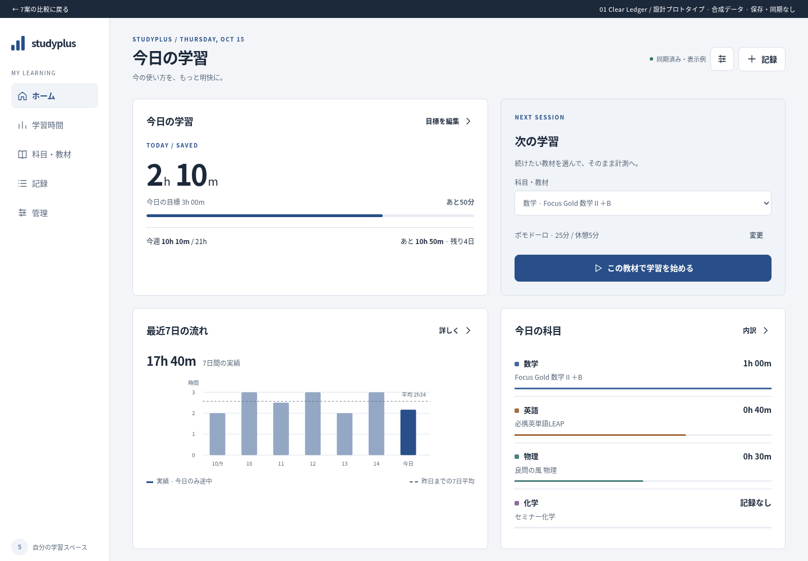</a></td><td><a href="screenshots/01-mobile-home.png">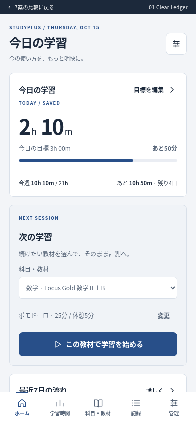</a></td></tr></table>

### 02 Flow Desk — 状況から、そのまま学習へ

**中程度の再設計・推薦**。今日の数値・週間の文脈・開始操作をひとつの行動面として統合。下段は比較に専念。

[設計の詳細](design-02/DESIGN.md) / [HTML](design-02/index.html) / [主要画面・PC](screenshots/02-desktop-major.png) / [主要画面・スマホ](screenshots/02-mobile-major.png) — 分析と比較

<table><tr><th>PC · 1440px</th><th>スマホ · 390px</th></tr><tr><td><a href="screenshots/02-desktop-home.png">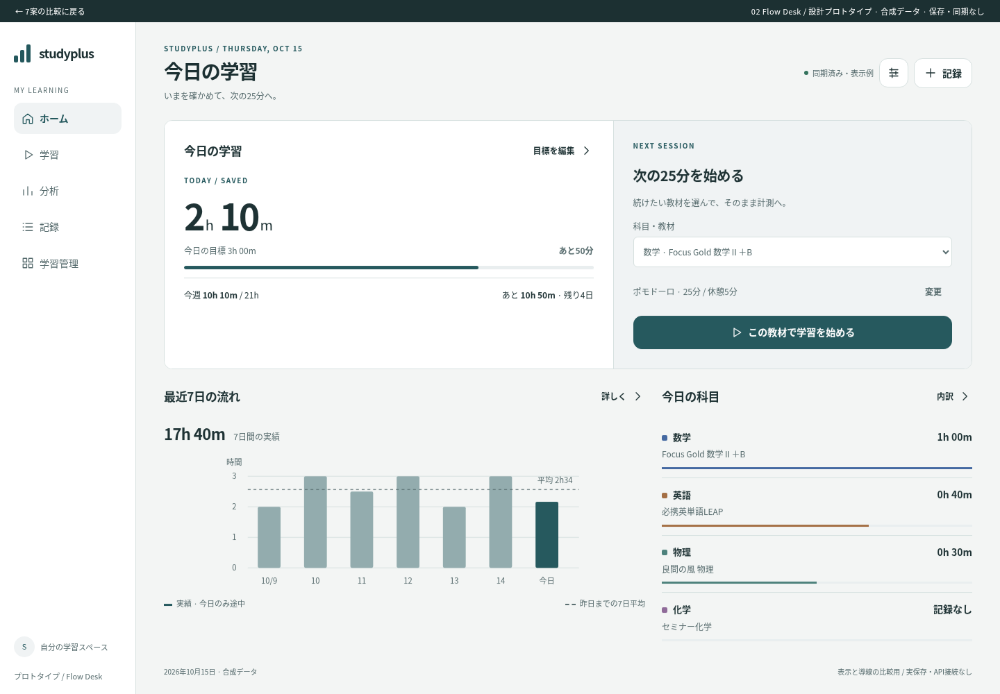</a></td><td><a href="screenshots/02-mobile-home.png">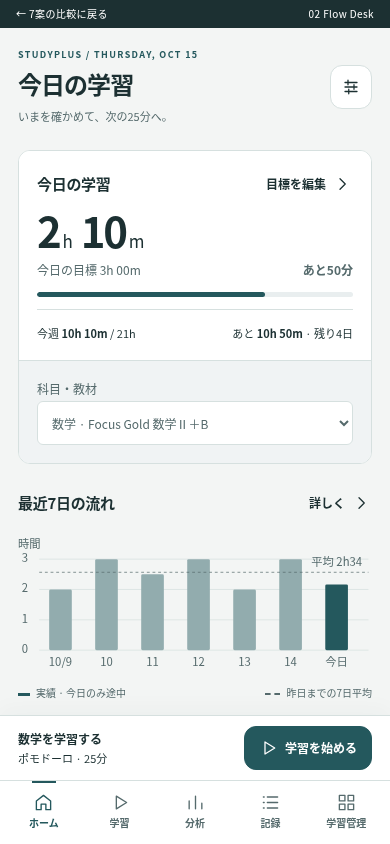</a></td></tr></table>

### 03 Insight Lab — 学習を読み解く分析卓

**大胆・分析ツール型**。ホームを比較可能なデータ面にする。フィルタ・指標・チャート・表を同じ列に揃える。

[設計の詳細](design-03/DESIGN.md) / [HTML](design-03/index.html) / [主要画面・PC](screenshots/03-desktop-major.png) / [主要画面・スマホ](screenshots/03-mobile-major.png) — 期間比較ワークベンチ

<table><tr><th>PC · 1440px</th><th>スマホ · 390px</th></tr><tr><td><a href="screenshots/03-desktop-home.png">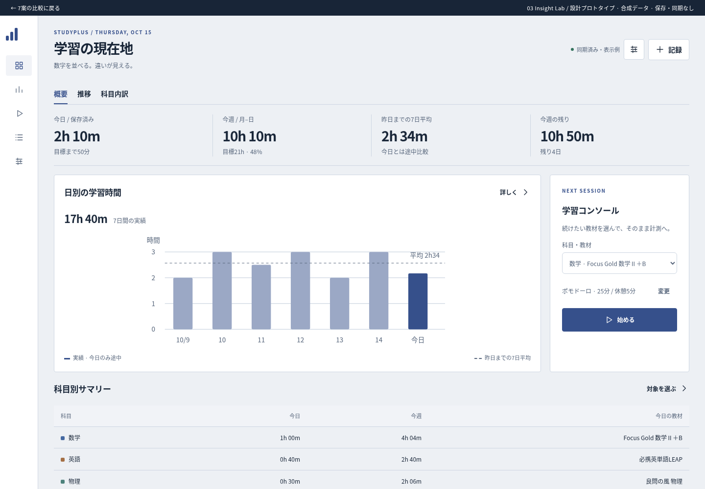</a></td><td><a href="screenshots/03-mobile-home.png">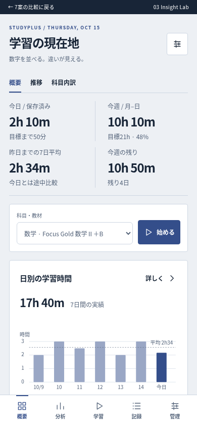</a></td></tr></table>

### 04 Pocket Focus — 手元の学習コンソール

**大胆・アプリ型**。今日の進捗をひと目で読める中心に置き、学習開始と記録を親指の範囲へ集約。

[設計の詳細](design-04/DESIGN.md) / [HTML](design-04/index.html) / [主要画面・PC](screenshots/04-desktop-major.png) / [主要画面・スマホ](screenshots/04-mobile-major.png) — 学習セッション

<table><tr><th>PC · 1440px</th><th>スマホ · 390px</th></tr><tr><td><a href="screenshots/04-desktop-home.png">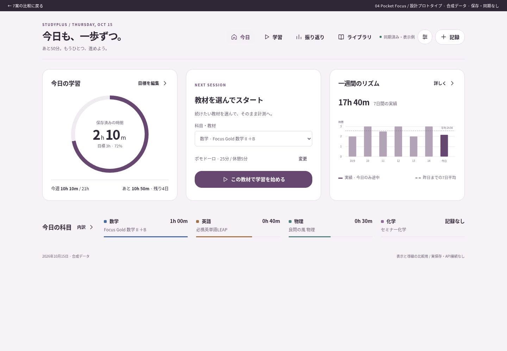</a></td><td><a href="screenshots/04-mobile-home.png">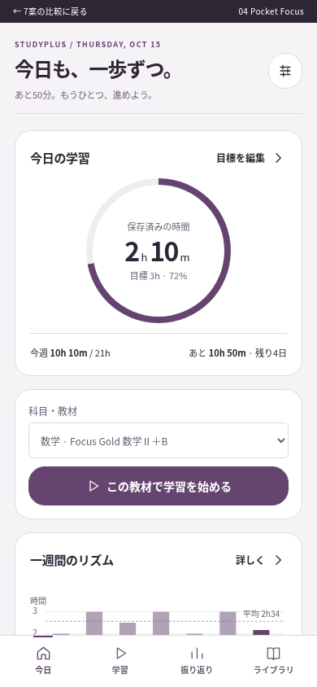</a></td></tr></table>

### 05 Daily Agenda — 今日の学習を組み立てる

**大胆・計画型／新機能提案**。記録と次に行うことを時間軸で結び、数値を今日の計画の文脈で読む。

[設計の詳細](design-05/DESIGN.md) / [HTML](design-05/index.html) / [主要画面・PC](screenshots/05-desktop-major.png) / [主要画面・スマホ](screenshots/05-mobile-major.png) — 学習計画ボード（新機能）

<table><tr><th>PC · 1440px</th><th>スマホ · 390px</th></tr><tr><td><a href="screenshots/05-desktop-home.png">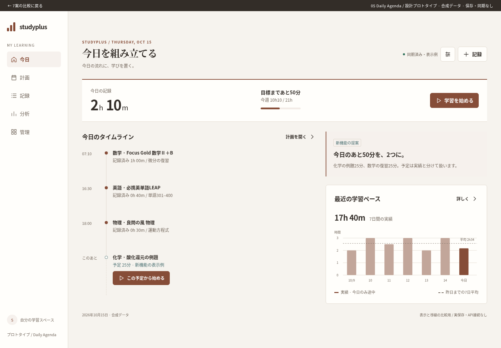</a></td><td><a href="screenshots/05-mobile-home.png">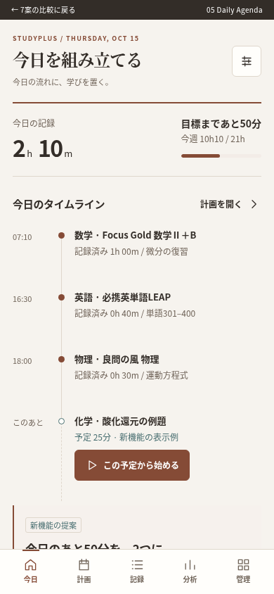</a></td></tr></table>

### 06 Subject Studio — 科目を起点にする学習室

**中〜大胆・対象中心**。普段選ぶ科目・教材を入口にし、その対象の実績・目標・記録を同じ場所に置く。

[設計の詳細](design-06/DESIGN.md) / [HTML](design-06/index.html) / [主要画面・PC](screenshots/06-desktop-major.png) / [主要画面・スマホ](screenshots/06-mobile-major.png) — 科目・教材ワークスペース

<table><tr><th>PC · 1440px</th><th>スマホ · 390px</th></tr><tr><td><a href="screenshots/06-desktop-home.png">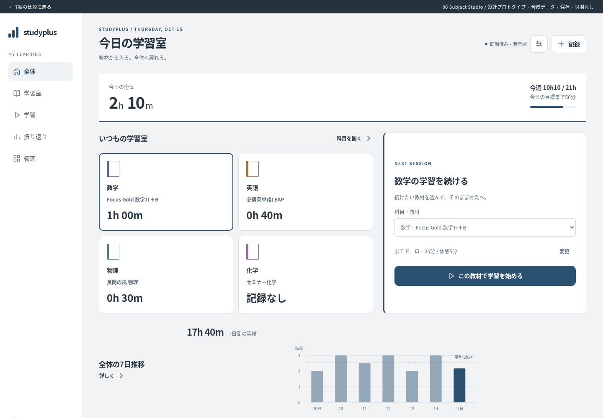</a></td><td><a href="screenshots/06-mobile-home.png">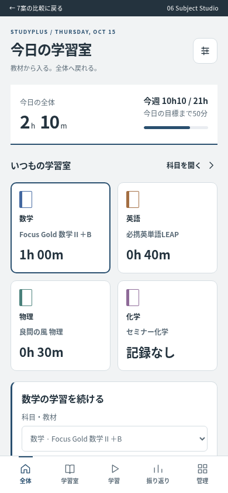</a></td></tr></table>

### 07 Weekly Canvas — 一週間の学習地図

**最も大胆・週から今日を捉える**。週を空間として見せ、今日を大きく選択。今日の行動と週間目標を常に同じ画面に置く。

[設計の詳細](design-07/DESIGN.md) / [HTML](design-07/index.html) / [主要画面・PC](screenshots/07-desktop-major.png) / [主要画面・スマホ](screenshots/07-mobile-major.png) — 週キャンバスと日別詳細

<table><tr><th>PC · 1440px</th><th>スマホ · 390px</th></tr><tr><td><a href="screenshots/07-desktop-home.png">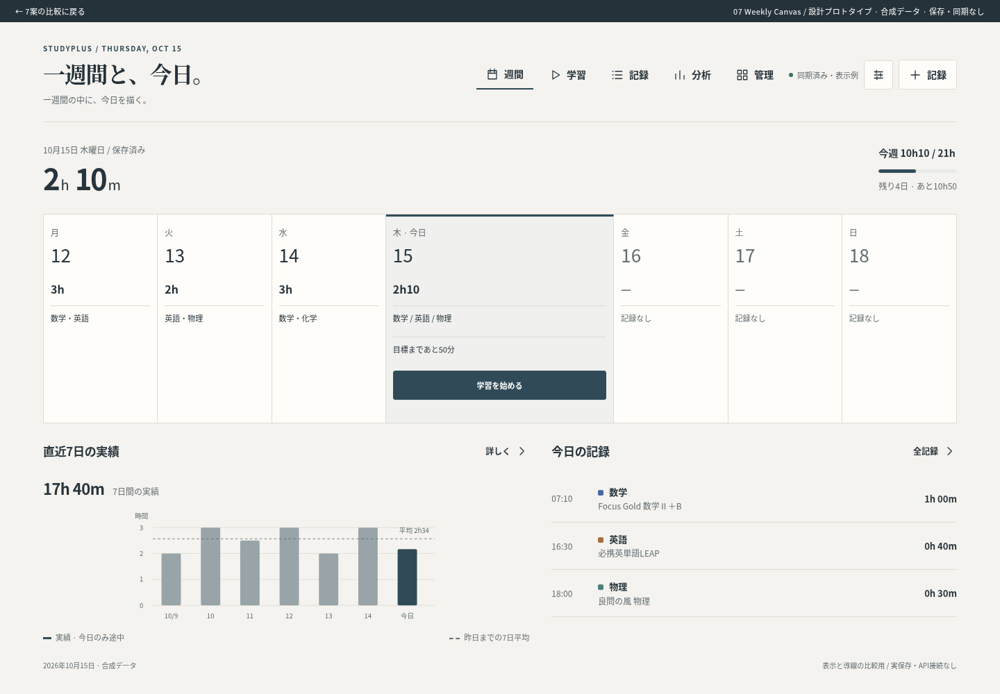</a></td><td><a href="screenshots/07-mobile-home.png">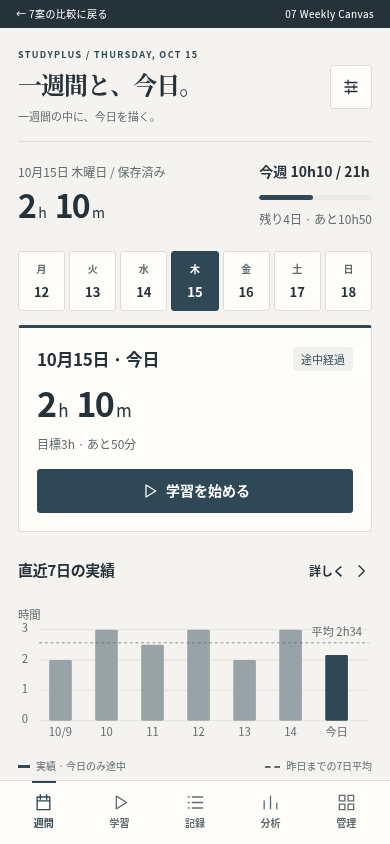</a></td></tr></table>

## 比較評価

10点満点。利用テストの実測値ではなく、構造・作業量に基づく設計判断です。難易度だけは高いほど難しいため、単純合計はしません。

|評価軸|01|02|03|04|05|06|07|
|---|---:|---:|---:|---:|---:|---:|---:|
|見た目|8|9|8|9|9|8|9|
|情報の整理|8|9|9|8|9|9|8|
|情報量と見やすさ|8|9|10|7|8|9|9|
|スマホ操作性|8|9|7|10|9|8|8|
|PC操作性|8|9|10|8|9|9|10|
|学習開始|8|10|7|10|9|9|8|
|グラフ|8|9|10|8|7|8|8|
|統一感|9|9|9|9|9|9|9|
|実装難易度（高いほど難）|3|5|8|6|9|7|8|
|保守性|9|9|7|8|6|8|7|
|拡張性|8|9|10|8|10|9|10|
|Studyplusとの相性|9|10|8|8|8|9|8|

## 確認結果と限界

- 7案 × 2画面 × 5幅（360/390/430/1280/1440px）＝70表示で横はみ出しなし。
- 各案の開始→計測→一時停止→方式変更→手入力のデモ導線をChromiumで確認。
- 各案のPC/スマホホーム＋主要画面、計28枚の画像。7案とも同じ合成データを基準にしています。
- [確認結果JSON](verification.json) / [現行の寸法記録](current/measurements.json) / [合成データ](current/fixture.json)
- 実機iPhone、Windowsのネイティブ入力、キーボード表示、支援技術での読み上げは未確認。
- 単一HTMLは外部依存を含めない構成です。ただし、この環境のブラウザポリシーが `file://` を禁止しているため、ファイルを直接開く操作は未確認です。画面検証はローカルHTTPで行いました。
- 保存・同期・API通信は行いません。模試・AI等は行き先の説明です。期間切替や教材長期値、予定は表示例です。
- 本番ソース・CSS・データ形式・計算式・保存処理は変更していません。アプリのテスト/ビルドは今回の成果物に不要なため実行していません。

## ファイル構成

- `index.html`：比較・分析・評価・推薦の入口
- `design-01/`〜`design-07/`：各案の単一HTMLと設計書
- `screenshots/`：28枚の初期画面画像
- `current/`：現行の比較画像6枚と合成データ、寸法記録
- `prototype.css` / `prototype.js` / `designs.json` / `build.py`：プロトタイプ生成元
- `verify.mjs`：本環境のChromiumによる確認用（Playwrightのパスとlocalhost:5176は環境依存）

採用案を選ぶまでは本番への適用、mainへのマージ、公開サイトの変更を行いません。
