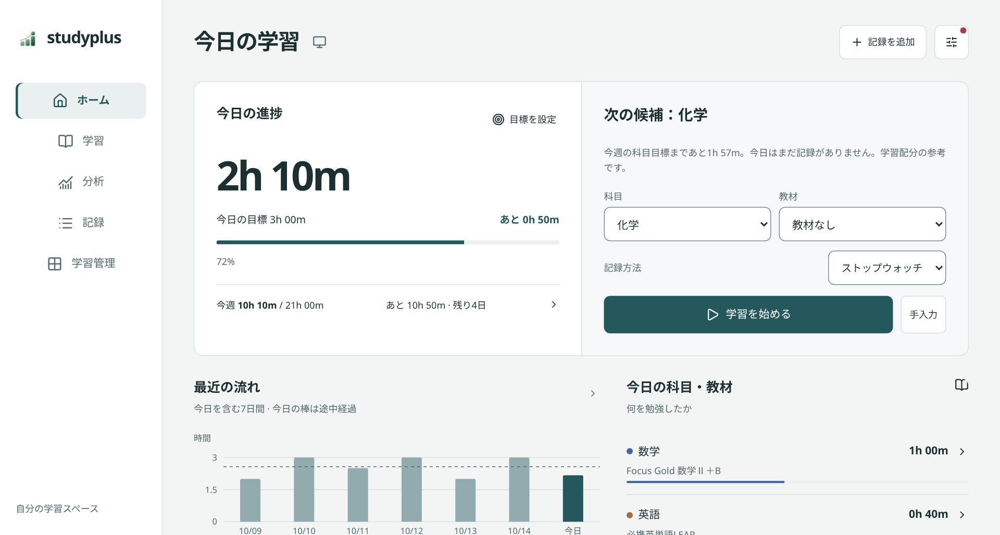
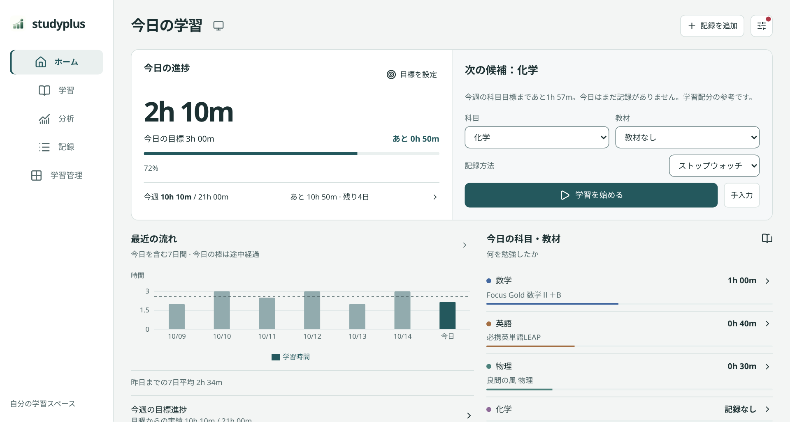
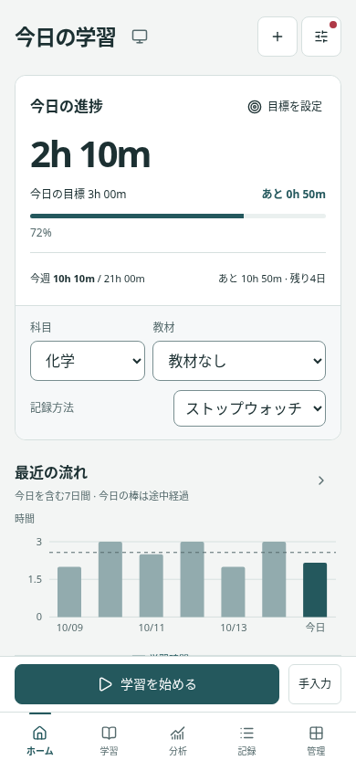
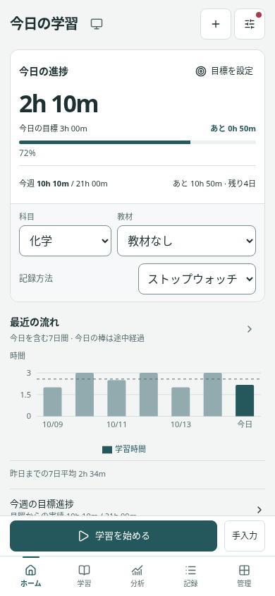

# UI密度の調整（2026-10-16）

同じ合成データ・ブラウザ・画面サイズでの変更前後。実際の学習データは含みません。

PCは1280×685 CSS px・表示スケール1.5（画像は1920×1028px）。スマホは390×844px。ブラウザの倍率やOSの拡大設定をアプリから変更する処理は追加していません。

| 画面 | 変更前 | 変更後 |
|---|---|---|
| PC |  |  |
| スマホ |  |  |

| 測定項目 | 変更前 | 変更後 |
|---|---:|---:|
| PCの上段エリア高さ（1280px幅） | 352px | 278px |
| PCの推移グラフの下端 | 724px | 589px |
| スマホの上段エリア高さ | 400px | 358px |
| スマホの推移グラフの下端 | 731px | 644px |

PCはサイドバー208→184px、ページ見出し28→24px、今日の時間52→44px、カード余白28→20px。スマホは見出し23→20px、今日の時間40→34px、下部ナビ64→56px（境界線を除く）。各画面のカード、表、指標、教材行も詰めています。

スマホ・タッチ端末は主要ボタンと入力欄の44px以上のタップ領域を保持。スマホの入力文字は16pxを維持し、iPhoneで入力時に自動拡大される原因を増やしていません。ホームのグラフ外枠は固定高さを外し、単位・凡例と描画領域が重ならないようにしました。

型チェック、Pages／オフライン／既存構成のビルド、8幅×15画面の回帰確認、計測の表示・操作テストが成功。オフラインHTMLと配布ZIPも更新します。実機のOS拡大率・ブラウザ倍率はこの環境から確認できないため、PC画像に近い表示スケールを指定して検証しています。
