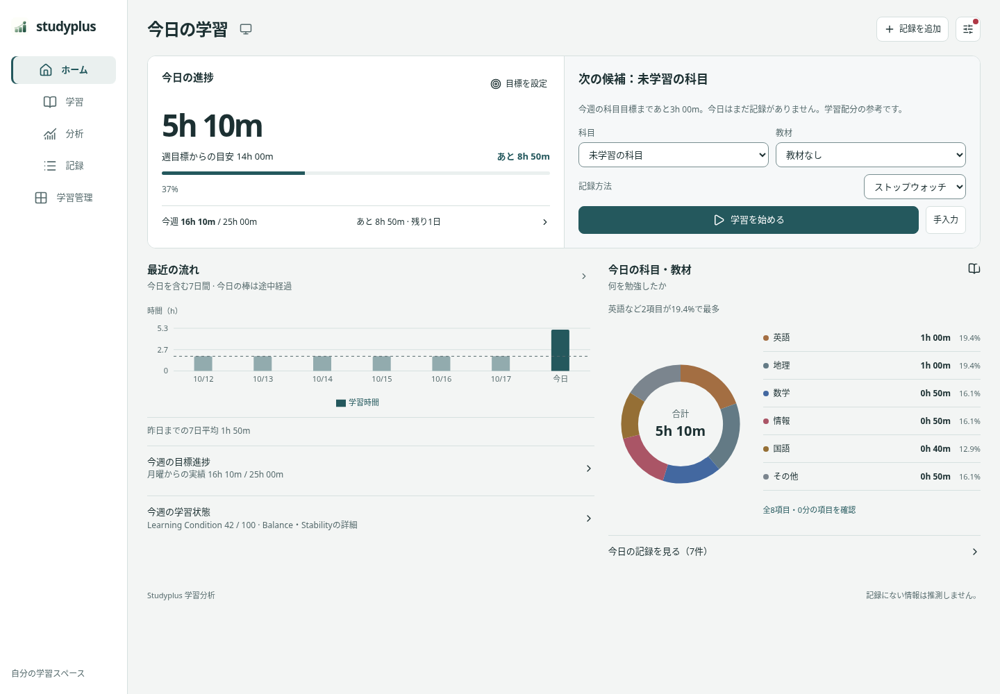
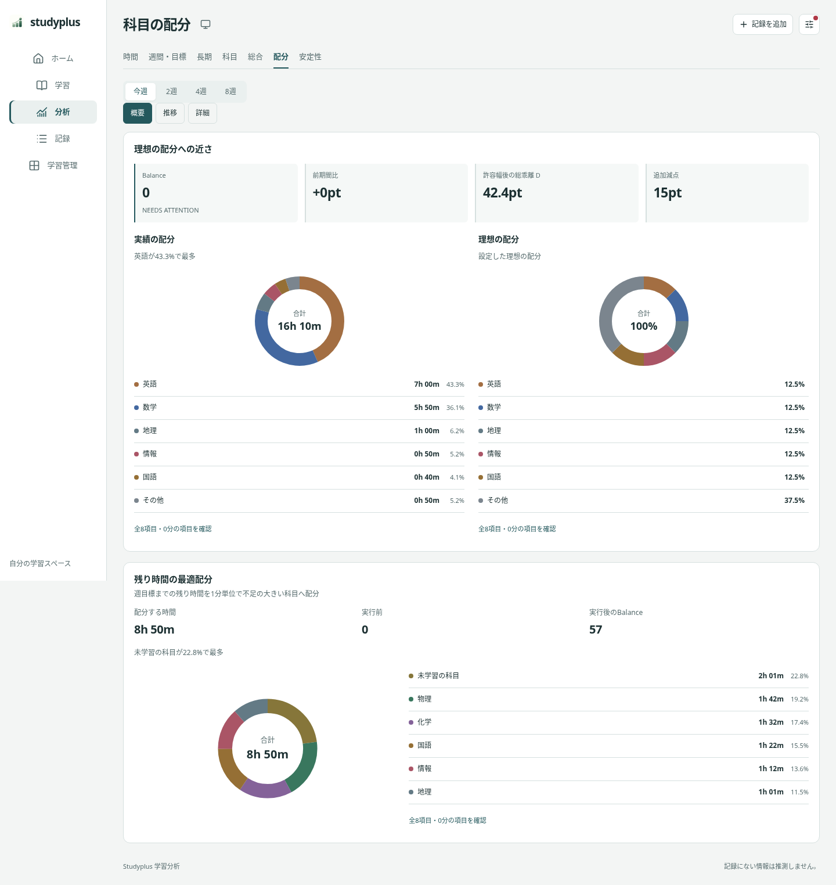
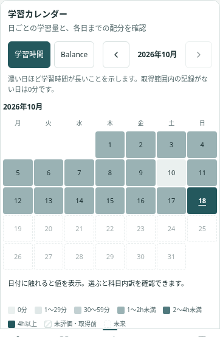
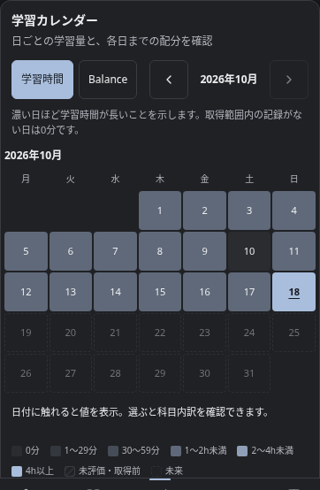
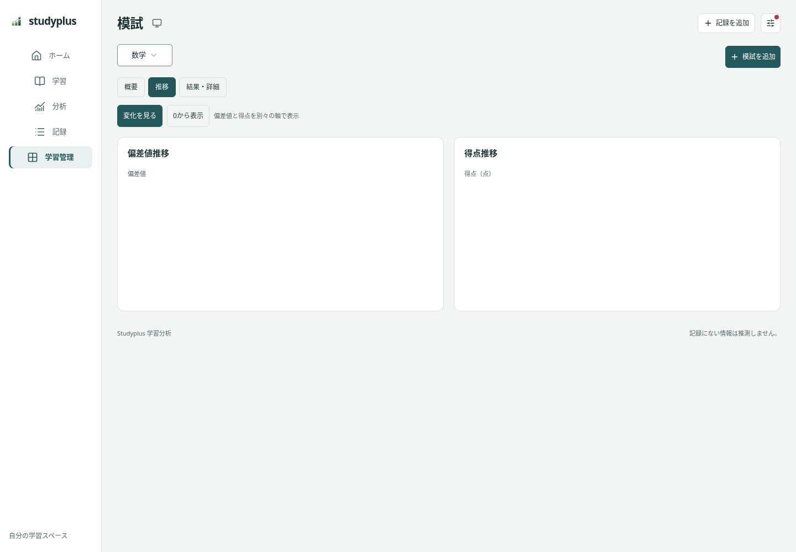

# 学習データの可視化（2026-10-18）

通常の画面を、要約 → 可視化 → 詳細の順に整理しました。画像と検証は合成データです。実ユーザーの記録・同期先にはアクセスしていません。

| 対象 | 表示・操作 |
|---|---|
| ホーム | 今日の科目をドーナツに集約。科目の選択で教材の内訳と記録・分析への入口を表示 |
| 時間帯 | 朝・昼・夕方・夜・不明のドーナツ。開始時刻による既存分類を維持 |
| 科目・教材 | 教材内訳をドーナツへ。全項目・並び順・0分を確認でき、教材から詳細へ移動。多数の教材の凡例にも指定順を反映 |
| Balance | 実績と理想を同じ科目色・同じ「その他」のグループで比較。優先順位は差分・理想位置のマーカーで表示 |
| トレンド | 増加・横ばい・減少の記号と説明、直近3日平均・前3日差、直近7日・前7日差のKPI |
| 学習カレンダー | 学習時間／Balanceを切替。PCは3か月、狭い画面は1か月。選択日から科目内訳・記録へ。月移動時は日別詳細を閉じる |
| 目標 | 科目・教材・週間目標を進捗バーで表示。実績・目標・不足・達成率と学習日数を保持 |
| 教材使用状況 | 未使用・最近未使用・継続・増加をアイコン付きの一覧に整理 |
| 模試 | 最新結果と比較可能な前回差をKPIに集約。偏差値・得点を別の縦軸にし、自動拡大／0から表示を切替 |

## 数値の意味

- Balanceヒートマップは各日を終点とする直近7日間を、現在の設定と既存の `analysis.scores` で計算します。日単位の新しい評価式は追加しません。
- ヒートマップは学習0分、未評価・取得前、未来の日を別表示にします。時間の濃さは0 / 1–29 / 30–59 / 60–119 / 120–239 / 240分以上、Balanceは0–19 / 20–39 / 40–59 / 60–79 / 80–100の固定区分です。
- 科目色はユーザー指定を維持。多数の項目は上位5件＋その他にまとめ、展開すると0分も含む全項目が見られます。実績と理想では同じ項目を「その他」にまとめます。
- 合計100%に満たない理想比率は円として正規化せず、設定を確認する表示にします。
- 模試は得点を勝手に100点満点に換算しません。満点情報は既存の `max_score` / `full_score` / `score_max` がある場合だけ使用。前回差は同科目・同系列、得点は確認できる同じ満点の場合に表示します。
- 模試の自動縦軸は全測定値を含め、偏差値は最低10、得点は最低20の幅を確保。軸の数値・単位を表示し、0からの表示にも戻せます。
- 記録・評価根拠・履歴・詳細値は削除せず、詳細タブや展開先で保持します。

## 実画面

| PCホーム | PCの配分比較 |
|---|---|
|  |  |

| カレンダー・スマホ | グラファイト |
|---|---|
|  |  |



## 検証

- 型チェック、単体テスト11ファイル（空／有データの画面描画を含む）、Pages／オフライン／既存構成のビルド成功。
- `visual-insights.test.mjs`：内訳合計・その他・未設定科目・色・0分の保持、既存Balanceとの一致、暦、縦軸、比較できる模試の条件。
- `visual-insights.browser.mjs`：Pagesとネットワーク無効のHTMLで、円の選択／全項目、未取得時刻、日付選択／矢印キー／記録への移動、目標、模試軸切替、8幅×7表示、データ不変、両モードの日付文字のコントラスト。
- 既存の `unified-workspace`、`record-management`、`color-mode`、オフラインの `pages` ブラウザテストも成功。保存・再読込、JSON往復、容量不足、別タブ競合、編集・削除、色・順序、計測開始、小窓を確認。
- 学習記録・設定・保存形式・同期方式・計算式・ライト／グラファイトのトークンは変更していません。
- 実機iPhone／Windowsのfile://直起動は未確認。Chromiumで生成HTMLをローカルURLから読み込み、通信を無効にして検証しています。

## 再現

```sh
npm run build:pages
npm run preview:pages
# 別のターミナルで実行（Playwrightが必要）
node tests/visual-insights.browser.mjs
```

ビルド済みPagesのローカル確認用コマンドを追加しました。依存ライブラリの追加はありません。
